# Actividad 4: Configuración de un Entorno de Desarrollo para JavaScript

**Estudiante:** [Carol Jineth Neira Buitrago]
**Curso:** [Tecnico En Codificación de sotfware] — Universidad de La Sabana
**Fecha:** [19/10/2026]
**Sistema operativo:** [Windows 10/11, macOS o Linux]

---

## 1. Introducción

### Objetivo 

El objetivo de esta actividad fue instalar y configurar un entorno de desarrollo local completo para **JavaScript**, de modo que pueda crear proyectos, gestionar sus dependencias y mantener la calidad del código de forma ordenada.

El entorno incluye:

- **Node.js:** permite ejecutar JavaScript fuera del navegador, directamente en el computador.
- **npm:** el gestor de paquetes que viene con Node.js; descarga e instala librerías.
- **Visual Studio Code (VSCode):** el editor/IDE donde escribo y ejecuto el código.
- **package.json:** archivo que describe el proyecto y registra sus dependencias.
- **ESLint y Prettier:** ESLint detecta errores y malas prácticas; Prettier formatea el código de manera uniforme.

### ¿Importancia de gestionar dependencias por proyecto?

En JavaScript, cada proyecto guarda sus librerías en su propia carpeta `node_modules`, y las versiones quedan registradas en `package.json`. Así, dos proyectos pueden usar versiones distintas de la misma librería sin conflictos, y cualquier persona puede reproducir mi entorno con un solo comando (`npm install`).

---

## 2. Pasos 

### Paso 1. Instalación de herramientas básicas

#### Instalar Node.js (incluye npm)

1. Entré a la página oficial: https://nodejs.org/
2. Descargué la versión **LTS** (soporte a largo plazo), que es la más estable y recomendada.
3. Ejecuté el instalador y acepté las opciones por defecto, dejando marcada la opción que agrega Node.js al **PATH**. Esto permite usar `node` y `npm` desde cualquier carpeta de la terminal.

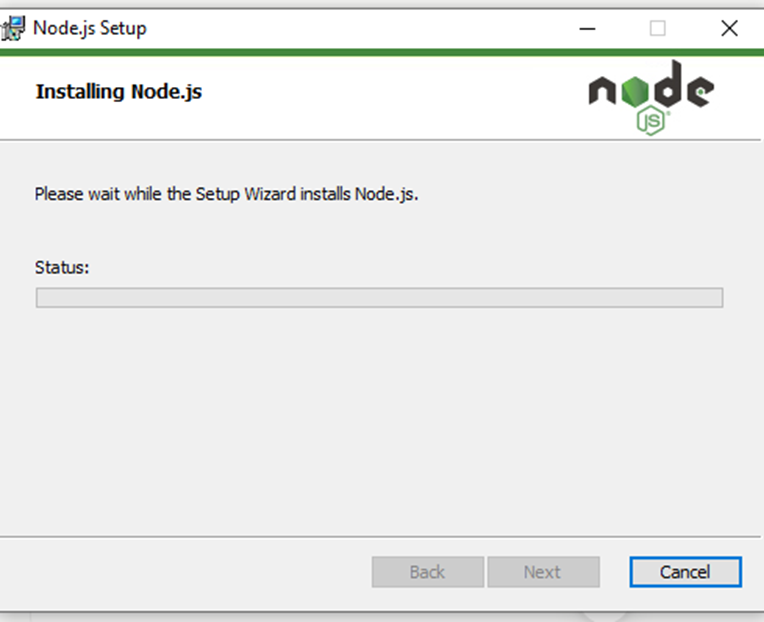

#### Instalar un IDE (Visual Studio Code)

1. Descargué VSCode desde https://code.visualstudio.com/
2. Lo instalé con las opciones por defecto.
3. Dentro de VSCode abrí la sección de Extensiones (`Ctrl + Shift + X`) e instalé:
   - **ESLint** (Microsoft): muestra los errores de código directamente en el editor.
   - **Prettier - Code formatter**: formatea el código al guardar.

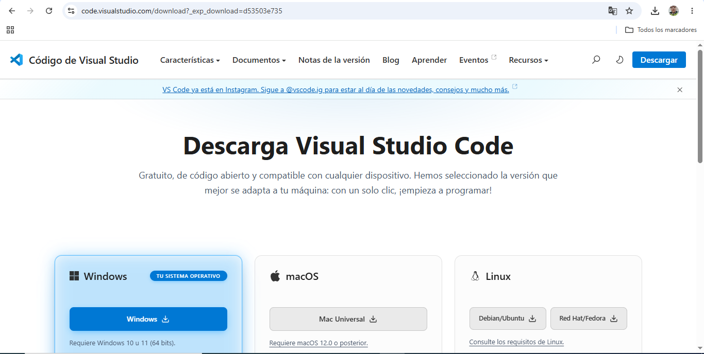

#### Verificar las instalaciones

Abrí una terminal (CMD, PowerShell o la terminal integrada de VSCode con `` Ctrl + ` ``) y ejecuté:

```bash
node -v
npm -v
```

Explicación: `-v` (o `--version`) muestra la versión instalada. Si el comando responde con un número, la instalación quedó bien y el PATH está correcto.

Salida esperada (los números pueden variar según tu instalación):

```
v22.x.x
10.x.x
```

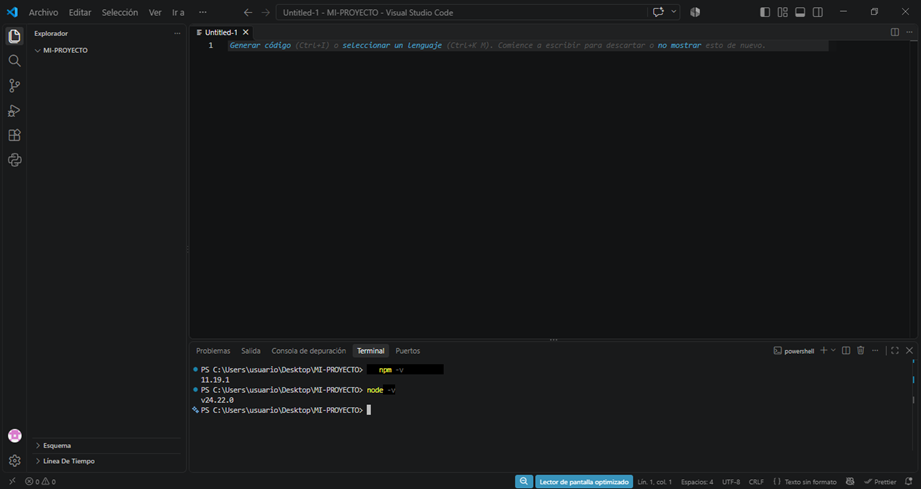
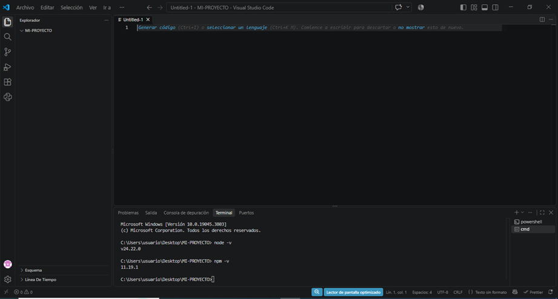

---

### Paso 2. Configuración avanzada

#### Inicializar el proyecto

Creé una carpeta para el proyecto, entré a ella e inicialicé npm: 

```bash
mkdir mi_proyecto
cd mi_proyecto
npm init -y
```

Explicación:

- `npm init` crea el archivo `package.json`, que es la "ficha" del proyecto (nombre, versión, scripts y dependencias).
- `-y` (yes) acepta todas las opciones por defecto para no tener que responder preguntas una por una.

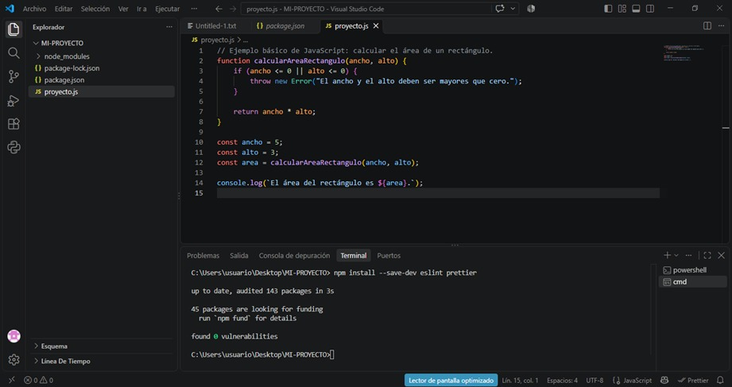

#### Instalar dependencias

Instalé las librerías del ejemplo:

```bash
npm install express lodash
```

- **express:** framework para crear servidores y aplicaciones web con Node.js.
- **lodash:** librería con funciones útiles para trabajar con arreglos, objetos y textos.

Esto hizo tres cosas: descargó los paquetes en la carpeta `node_modules/`, los registró en la sección `dependencies` de `package.json` y creó el archivo `package-lock.json`, que fija las versiones exactas instaladas.

Verifiqué lo instalado con:

```bash
npm list --depth=0
```
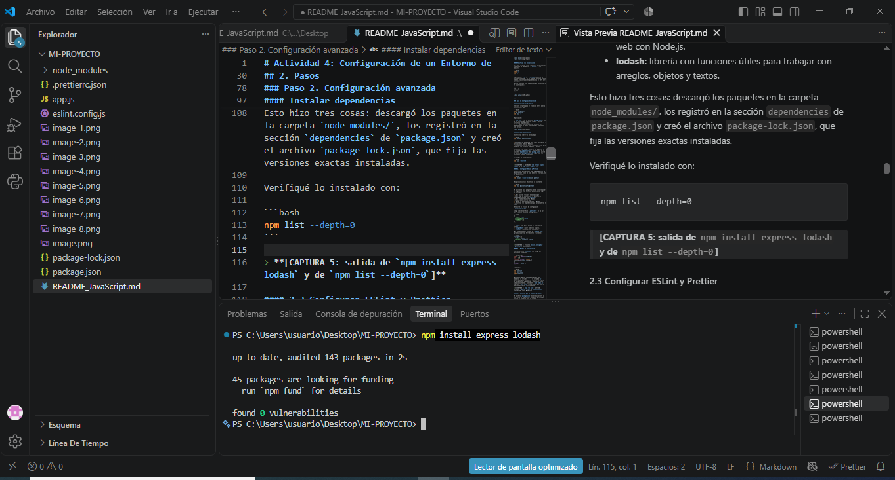
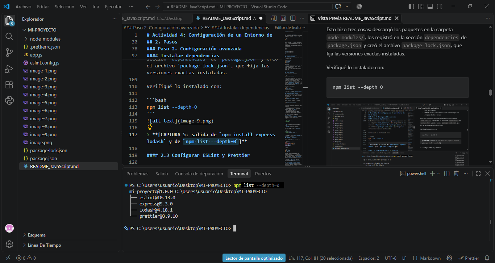

#### Configurar ESLint y Prettier

Instalé las herramientas como **dependencias de desarrollo** (solo se usan mientras programo, no en producción):

```bash
npm install --save-dev eslint prettier
```
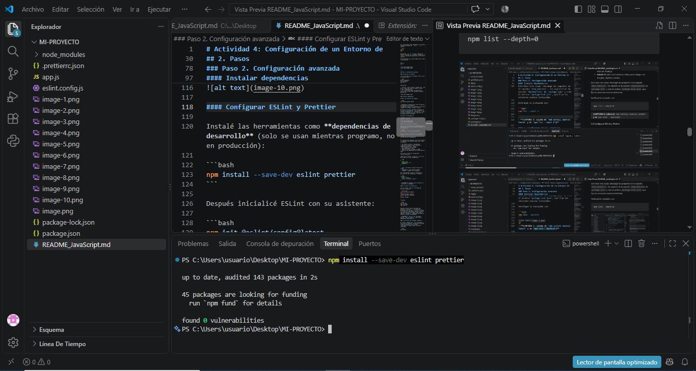

Después inicialicé ESLint con su asistente:

```bash
npm init @eslint/config@latest
```
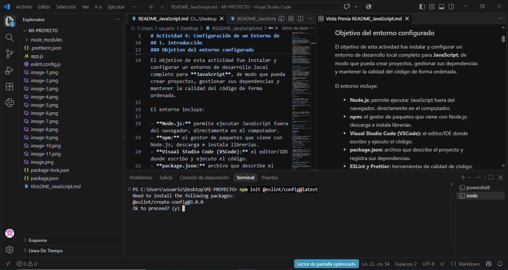

(las opciones pueden variar según la versión):

- ¿Qué quieres revisar? → *JavaScript*
- ¿Qué tipo de módulos usa tu proyecto? → *CommonJS* (porque uso `require`)
- ¿Qué framework usas? → *None*
- ¿Usas TypeScript? → *No*
- ¿Dónde se ejecuta tu código? → *Node*
- ¿Instalar las dependencias que faltan ahora? → *Yes*

Esto creó el archivo de configuración `eslint.config.mjs`.

Luego creé el archivo `.prettierrc.json` en la raíz del proyecto con esta configuración:

```json
{
  "singleQuote": true,
  "semi": true,
  "printWidth": 88
}
```

- `semi`: usar punto y coma al final de las líneas.
- `singleQuote`: usar comillas simples.
- `tabWidth`: indentar con 2 espacios.

Por último agregué scripts en `package.json` para ejecutar las herramientas fácilmente:

```json
{
  "name": "mi-proyecto",
  "version": "1.0.0",
  "description": "",
  "main": "index.js",
  "scripts": {
    "test": "echo \"Error: no test specified\" && exit 1",
    "start": "node app.js",
"lint": "eslint app.js",
"format": "prettier --write app.js eslint.config.js"
  },
  "keywords": [],
  "author": "",
  "license": "ISC",
  "type": "commonjs",
  "dependencies": {
    "express": "^5.3.0",
    "lodash": "^4.18.1"
  },
  "devDependencies": {
    "eslint": "^10.13.0",
    "prettier": "^3.9.10"
  }
}

```

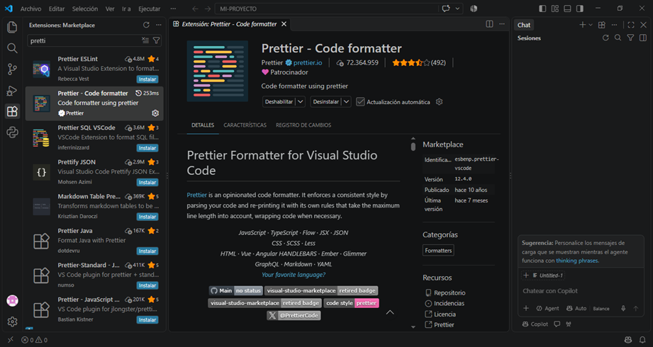
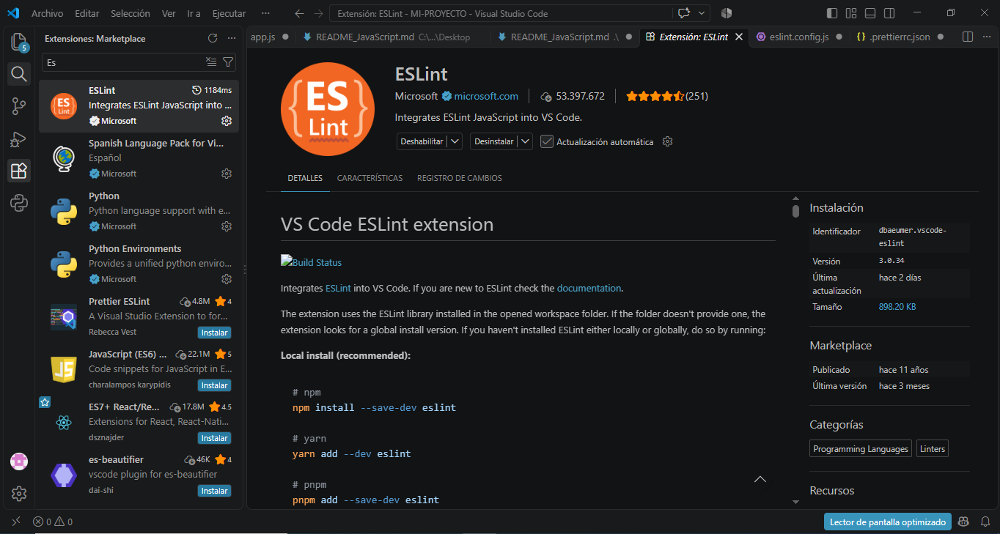


#### Probar la configuración

Creé un archivo `index.js` con código mal escrito a propósito:

```javascript
const _ = require("lodash")
var x = 5
function saludar( nombre ){
console.log("Hola "+nombre)
}
saludar( "Mundo" )
```

Y ejecuté:

```bash
npm run lint
npm run format
node index.js
```

Resultado: ESLint reportó problemas (por ejemplo, la variable `_` y la variable `x` declaradas pero sin usar). Prettier reformateó el archivo con indentación, comillas y punto y coma consistentes. Finalmente `node index.js` imprimió `Hola Mundo`, comprobando que Node.js ejecuta el código correctamente.

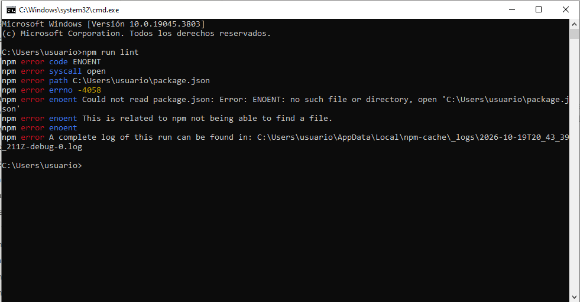
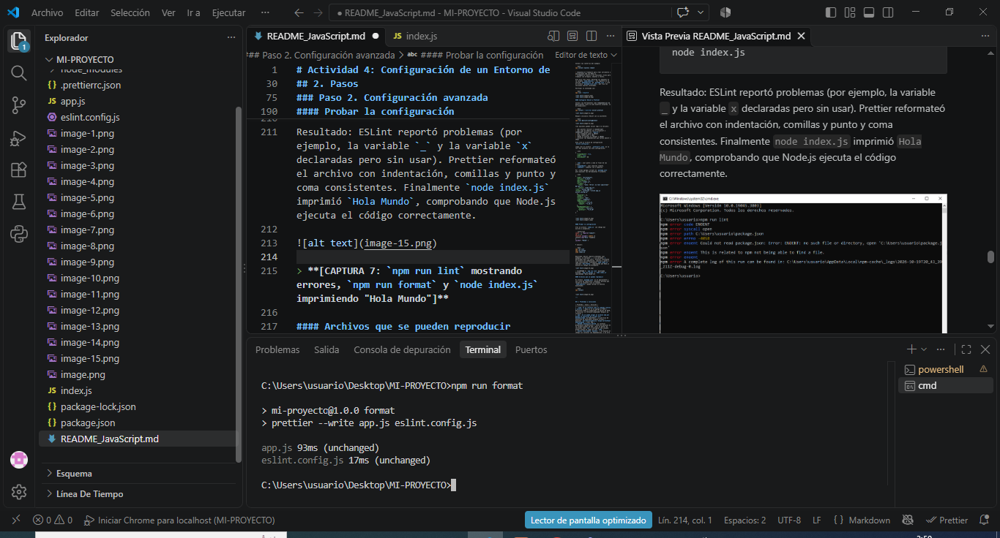


#### Archivos que se pueden reproducir

El archivo `package.json` es el equivalente a una lista de requisitos: cualquier persona que reciba mi proyecto (sin la carpeta `node_modules`) puede recrear el entorno ejecutando:

```bash
npm install
```

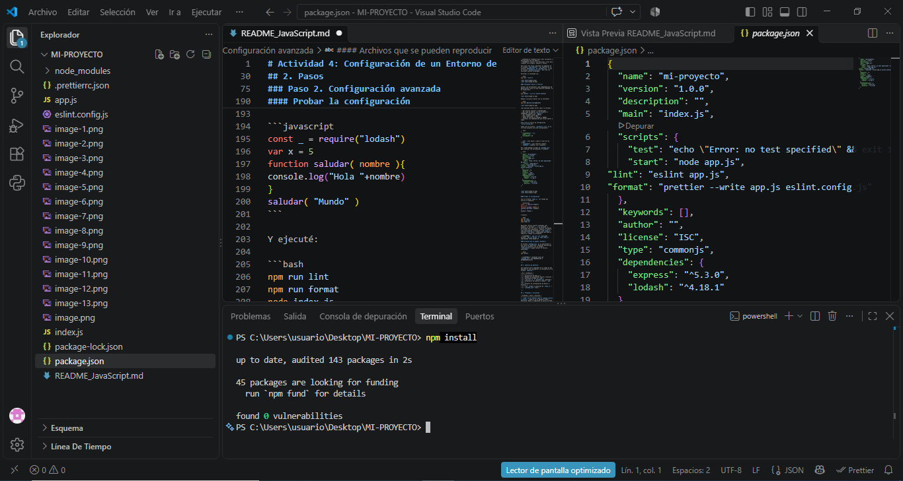

---


## 4. Problemas y soluciones

| Problema | Causa | Solución |
|----------|-------|----------|
| `'node' no se reconoce como un comando interno o externo` | Node.js no se agregó al PATH | Reinstalar Node.js asegurando la opción de PATH, o reiniciar la terminal/computador después de instalar |
| `npm : no se puede cargar el archivo npm.ps1 porque la ejecución de scripts está deshabilitada` en PowerShell | La política de ejecución de PowerShell bloquea scripts | Ejecutar `Set-ExecutionPolicy -Scope CurrentUser RemoteSigned` o usar CMD |
| `EACCES: permission denied` al instalar globalmente (macOS/Linux) | Falta de permisos en la carpeta global de npm | Usar un gestor de versiones como `nvm` o configurar una carpeta global propia en lugar de usar `sudo` |
| `Cannot find module 'express'` | Se ejecutó el código sin instalar las dependencias, o en otra carpeta | Ejecutar `npm install` dentro de la carpeta del proyecto |
| ESLint no marca errores en VSCode | Falta la extensión o el archivo de configuración | Instalar la extensión ESLint y verificar que exista `eslint.config.mjs`; reiniciar VSCode |
| Conflicto entre ESLint y Prettier (reglas de formato contradictorias) | Ambas herramientas opinan sobre el formato | Instalar `eslint-config-prettier` para desactivar las reglas de ESLint que chocan con Prettier |

---

## Referencias 
https://code.visualstudio.com/download?_exp_download=d53503e735

https://nodejs.org/es/download

https://developer.mozilla.org/es/docs/Web/JavaScript

https://docs.npmjs.com/cli/commands/npm-init

https://docs.npmjs.com/cli/commands/npm-install

https://docs.npmjs.com/cli/commands/npm-ls

https://docs.npmjs.com/cli/configuring-npm/package-json

https://code.visualstudio.com/docs/terminal/basics

https://eslint.org/docs/latest/use/getting-started

https://prettier.io/docs/configuration


## 5. Conclusiones

Configurar un entorno de desarrollo para JavaScript con Node.js y npm me permitió entender cómo se gestionan las dependencias de un proyecto mediante `package.json`, y cómo reproducir el entorno en otro computador con un solo comando. El uso de ESLint y Prettier ayuda a detectar errores a tiempo y a mantener un estilo de código uniforme, lo cual es especialmente valioso en el trabajo en equipo. 

---